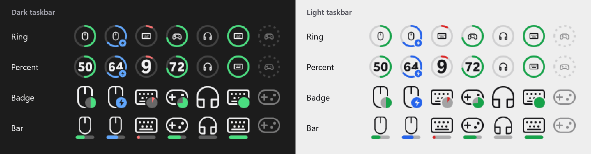
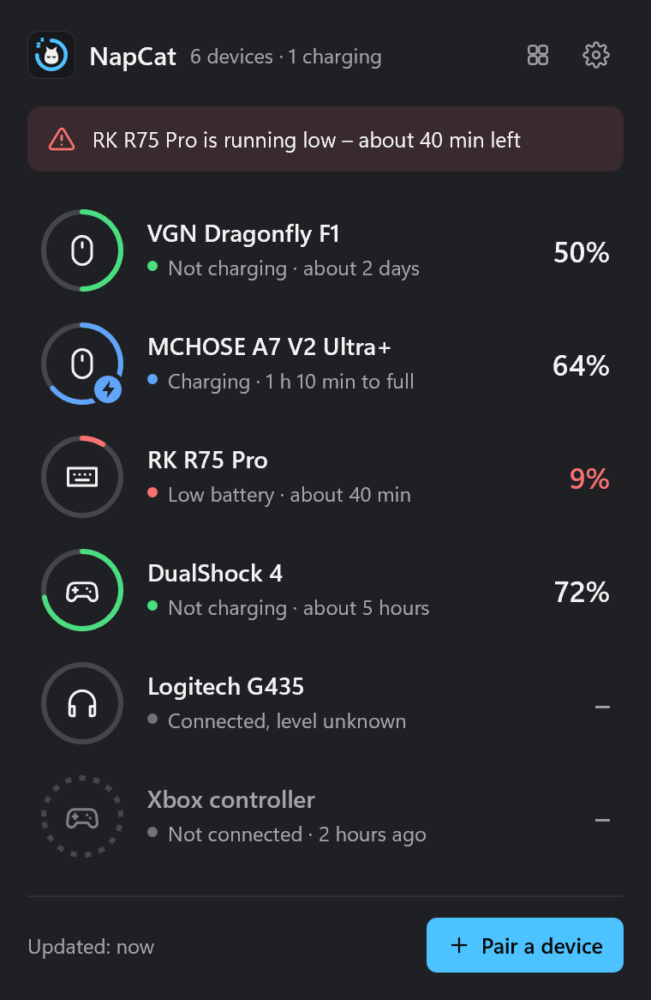
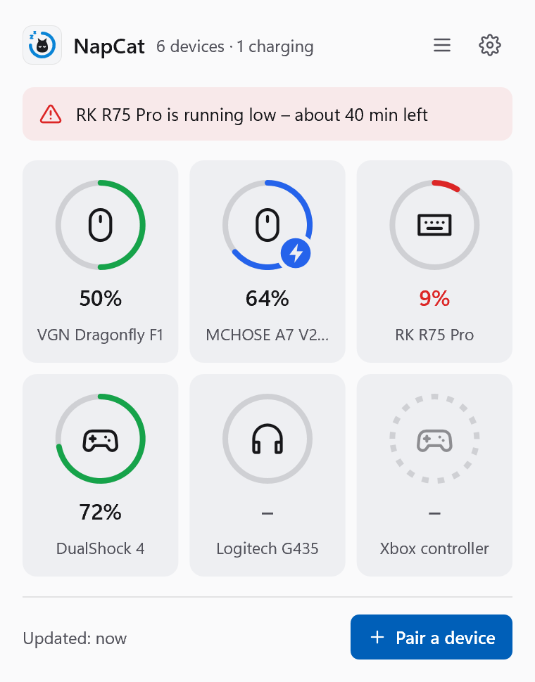
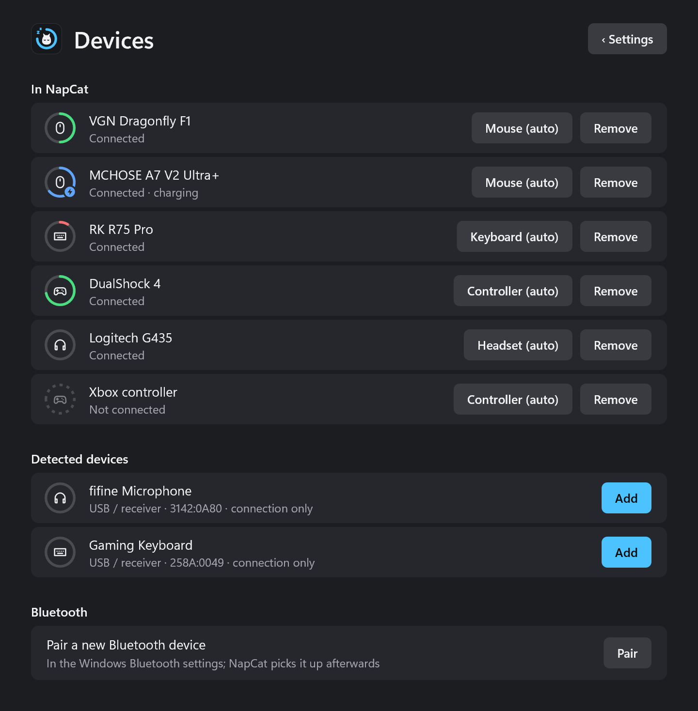
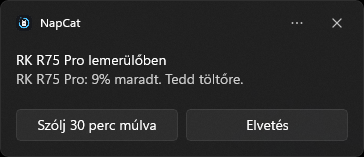
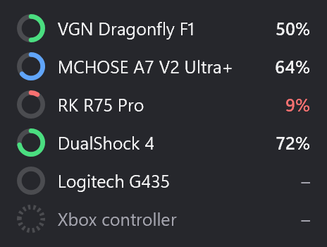

# NapCat

Battery levels of your wireless devices, right in the Windows taskbar.

Each device gets its own tray icon: the device glyph surrounded by a ring that shows the charge
level, with a lightning badge while charging. Written in Rust on plain Win32, Direct2D and WinRT:
no WebView, no UI framework, and practically zero CPU when idle.

<p align="center">
  <a href="docs/gallery/tray/icon-styles.png">
    
  </a>
</p>

> Early development. Windows 10 and 11.

[Screenshots](#screenshots) · [Status](#status) · [Building](#building) · [Full gallery](docs/gallery/README.md)

## Screenshots

<table>
  <tr>
    <td width="50%" valign="top">
      <a href="docs/gallery/flyout/list-dark.png"></a><br>
      <strong>Flyout panel</strong><br>
      Click the tray icon: every device with its level, charging state, time estimate and low-battery alert.
    </td>
    <td width="50%" valign="top">
      <a href="docs/gallery/flyout/grid-light.png"></a><br>
      <strong>Grid view</strong><br>
      The same panel as tiles, here with the light theme.
    </td>
  </tr>
  <tr>
    <td width="50%" valign="top">
      <a href="docs/gallery/settings/devices-dark.png"></a><br>
      <strong>Devices</strong><br>
      Remove, retype or add devices, including ones Windows detects but NapCat has no protocol for.
    </td>
    <td width="50%" valign="top">
      <a href="docs/gallery/notifications/low-battery.png"></a><br>
      <strong>Low battery</strong><br>
      A notification with snooze, held back while a game or film is in full screen.
      <br><br>
      <a href="docs/gallery/tooltip/dark.png"></a><br>
      <strong>Tooltip</strong><br>
      Hover a tray icon for the details.
    </td>
  </tr>
</table>

The [settings page](docs/gallery/settings/general-dark.png) shows the version and installs updates
with one click. Screenshots show the English UI with simulated devices; the
[full gallery](docs/gallery/README.md) has all 14 images and capture details.

## Status

| Feature | |
|---|---|
| Tray icons (one per device or one for the most urgent), ring / percent / badge / bar styles | done |
| Flyout panel, rich tooltip, settings window, Devices page (add, remove, reorder, type) | done |
| English and Hungarian UI (follows the Windows display language, or pick one in settings) | done |
| Toast notifications (low battery with snooze, fully charged), quiet mode in full screen | done |
| Time estimates from level history | done |
| Installer (Inno Setup), auto-update from GitHub Releases via [catninth/updater](https://github.com/catninth/updater) | done |
| PlayStation controllers (DualSense, DualSense Edge, DualShock 4; USB and Bluetooth) | done, tested with DualShock 4 over USB |
| Compx receivers (VGN, ATK, VXE mice) | done, tested with VGN Dragonfly |
| MCHOSE mice (A7 V2 Pro/Pro+/Ultra/Ultra+; cable and receiver) | done, tested with A7 V2 Ultra+ on the 8K receiver |
| Xbox controllers (XInput, approximate level) | done, untested on hardware |
| Logitech HID++ 2.0 (Unifying, Bolt, Lightspeed, wired) | done, untested on hardware |
| Bluetooth battery (Windows battery property) | done, untested on hardware |
| Headsets (other than Logitech), Razer, BLE GATT | planned |

## Building

Requires the Rust MSVC toolchain and, for the installer, [Inno Setup 6](https://jrsoftware.org/isdl.php).

```sh
cargo build --release                # target\release\napcat.exe (run it directly, no install needed)
cargo test --release                 # tests; also renders icon previews to target\*.png
iscc installer\napcat.iss            # installer -> target\installer\NapCat-Setup-<version>.exe
```

`.github/workflows/build.yml` builds, tests and packages the installer on every push and on manual
runs (the exe and installer are attached to the run as an artifact). Releases are built by
`.github/workflows/release.yml` when a `v*` tag is pushed; the tag must match the version in
`Cargo.toml`.

## Tools

- `tools/diag` – lists HID interfaces, Bluetooth battery properties and standard HID battery
  usages; `via` sends read-only VIA queries, `listen` passively logs vendor-defined reports.
- `tools/webhid-logger.js` – paste into the DevTools console of a vendor's web driver to log its
  WebHID traffic (used to find battery commands).
