# NapCat feature gallery

Real NapCat UI in English (the app follows the Windows display language; Hungarian is also built in), with the same linked, two-column layout as the
ClipCat and GitCat galleries. Click any image to open the full-resolution PNG.

The flyout panel, tooltip and settings window are drawn by NapCat's own Direct2D code into an
offscreen bitmap at 2× resolution (192 DPI), so they show the window contents without the Windows
frame and title bar. Settings pages are captured at their full scrolling height. Tray icons are the
real 32 px icons a 200% taskbar uses, enlarged 2× pixel for pixel.
Notification screenshots are not included yet: they are real Windows toasts, captured from the screen.

The devices are simulated: a VGN Dragonfly F1 at 50%, an MCHOSE A7 V2 Ultra+ charging, an RK R75
Pro keyboard at 9%, a DualShock 4, a Logitech G435 with an unknown level and a disconnected Xbox
controller. The accent color is fixed to the design blue so the images don't depend on the
Windows accent color. The interface is NapCat v0.1.1 at commit `5905a55`. To recreate the images,
run `cargo test --release ui::gallery -- --ignored --test-threads=1` (the toast capture, `gallery_toasts`, shows two
notifications on screen and expects the dark Windows theme).

[Flyout panel](#flyout-panel) · [Tooltip](#tooltip) · [Settings](#settings) · [Devices](#devices) · [Statistics](#statistics) · [Tray icons](#tray-icons)

## Flyout panel

<table>
  <tr>
    <td width="50%" valign="top">
      <a href="flyout/list-dark.png">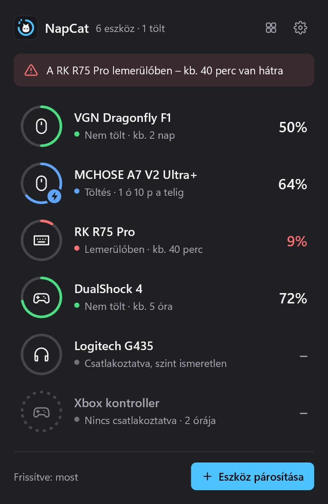</a> 
      <strong>List view</strong> 
      Left-click a tray icon: every device with its level, charging state and time estimate, plus a low-battery alert at the top.
    </td>
    <td width="50%" valign="top">
      <a href="flyout/list-light.png">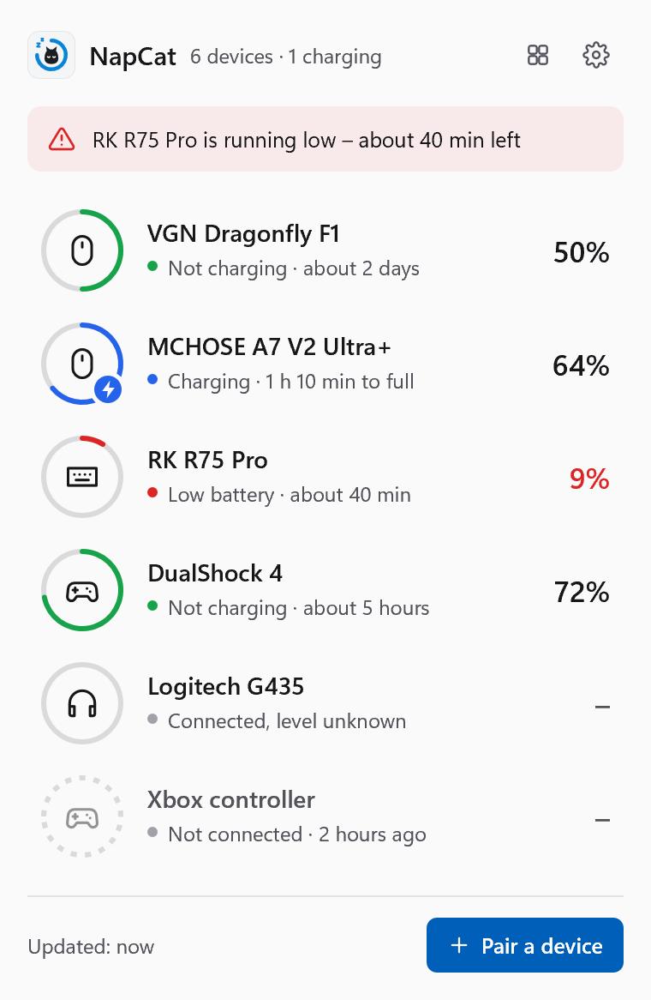</a> 
      <strong>Light theme</strong> 
      The panel follows the taskbar theme, or the theme chosen in Settings.
    </td>
  </tr>
  <tr>
    <td width="50%" valign="top">
      <a href="flyout/grid-dark.png">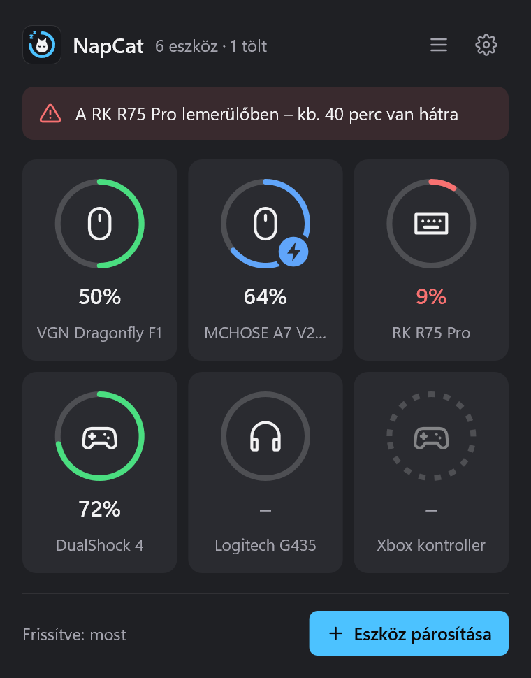</a> 
      <strong>Grid view</strong> 
      Larger rings in tiles, switched with the button next to the settings gear.
    </td>
    <td width="50%" valign="top">
      <a href="flyout/grid-light.png">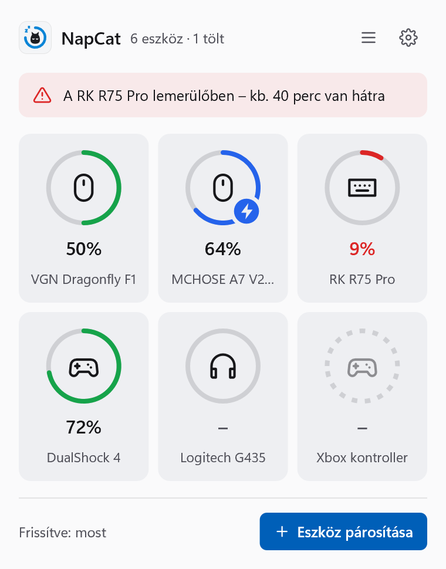</a> 
      <strong>Grid view, light</strong> 
      Disconnected devices keep a dashed ring and their last-seen time.
    </td>
  </tr>
</table>

## Tooltip

<table>
  <tr>
    <td width="50%" valign="top">
      <a href="tooltip/dark.png">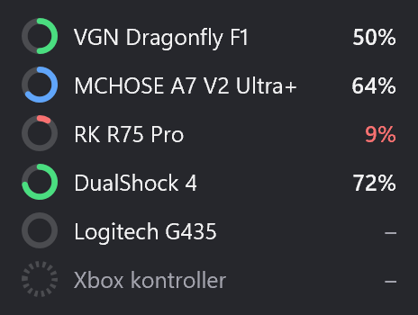</a> 
      <strong>Rich tooltip</strong> 
      Hover a tray icon to see every device at a glance, without clicking.
    </td>
    <td width="50%" valign="top">
      <a href="tooltip/light.png">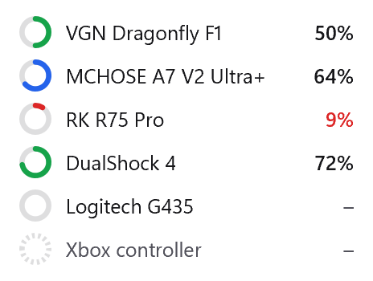</a> 
      <strong>Light theme</strong> 
      Low levels are highlighted in red; unknown levels show a dash.
    </td>
  </tr>
</table>

## Settings

<table>
  <tr>
    <td width="50%" valign="top">
      <a href="settings/general-dark.png">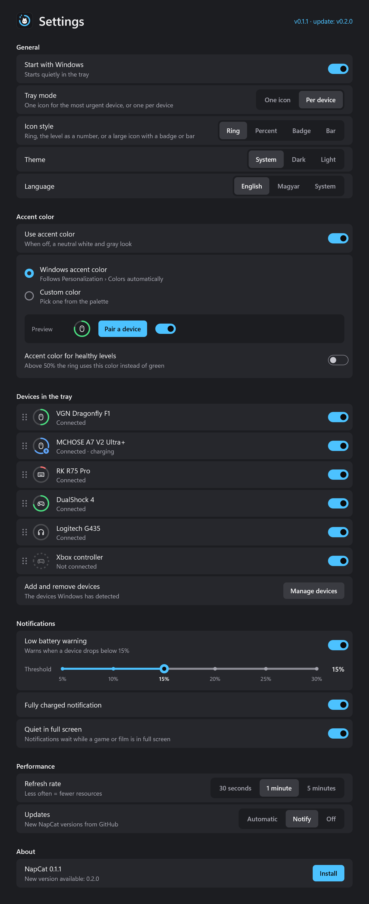</a> 
      <strong>Settings</strong> 
      Startup, tray mode, icon style, theme, language, accent color, per-device tray icons, notifications, refresh rate, and the version with one-click update install.
    </td>
    <td width="50%" valign="top">
      <a href="settings/general-light.png">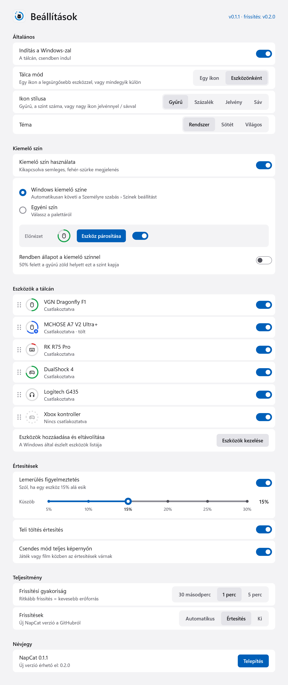</a> 
      <strong>Light theme</strong> 
      Every change applies immediately; tray icons can be reordered by dragging.
    </td>
  </tr>
</table>

## Devices

<table>
  <tr>
    <td width="50%" valign="top">
      <a href="settings/devices-dark.png">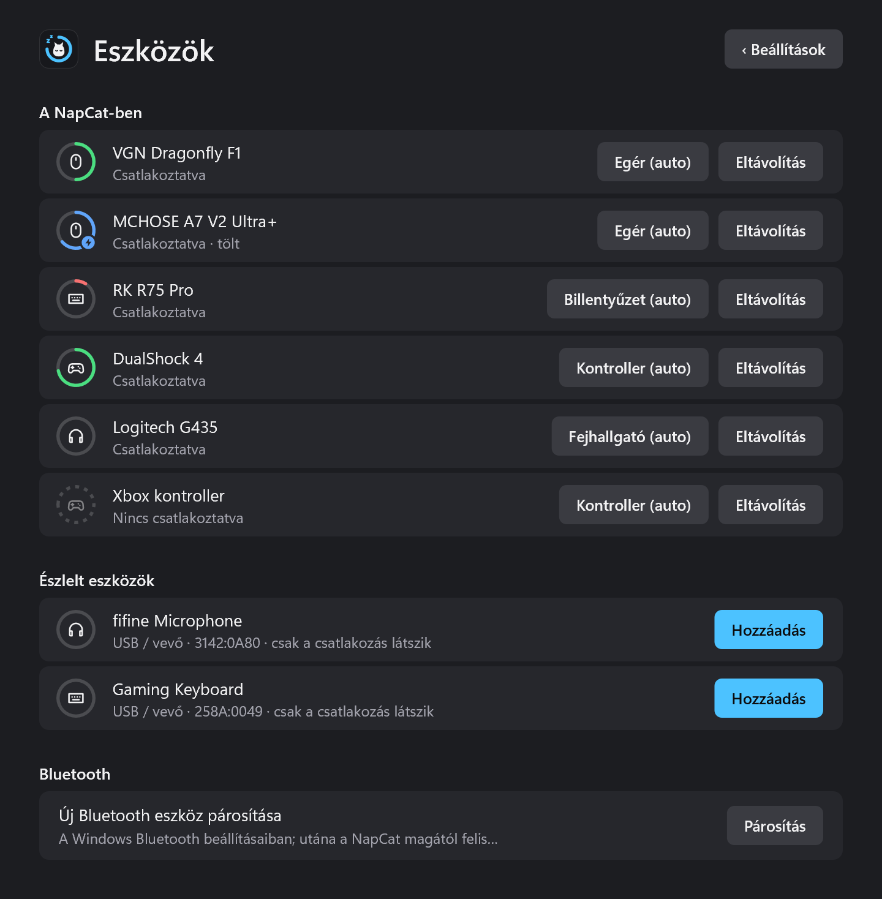</a> 
      <strong>Devices page</strong> 
      Remove devices, override their type, and add USB devices Windows sees but NapCat does not support yet.
    </td>
    <td width="50%" valign="top">
      <a href="settings/devices-light.png">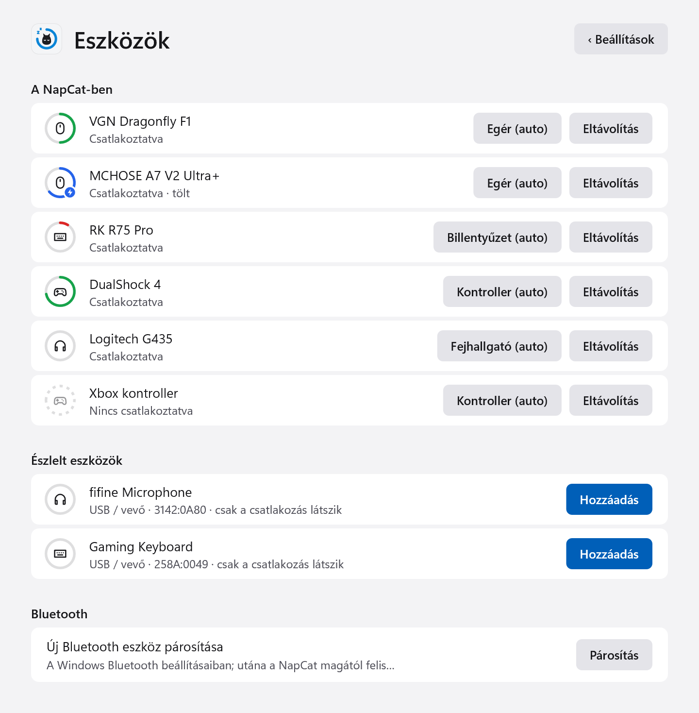</a> 
      <strong>Light theme</strong> 
      Unsupported devices show their USB ID and connection state only; Bluetooth pairing opens Windows settings.
    </td>
  </tr>
</table>

## Statistics

<table>
  <tr>
    <td width="50%" valign="top">
      <a href="stats/dark.png">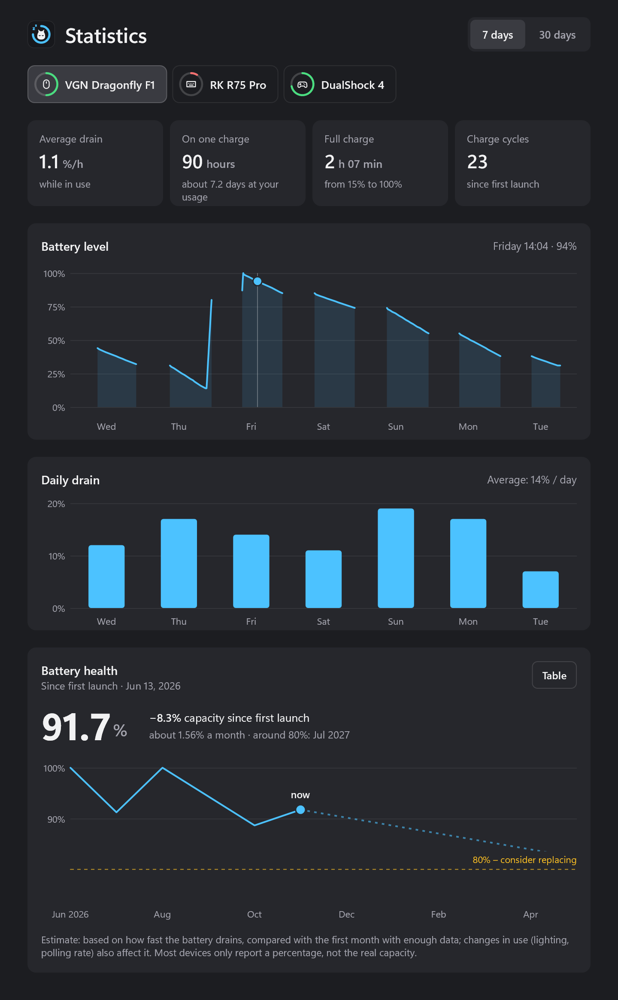</a> 
      <strong>Statistics</strong> 
      Per device: average drain, runtime on one charge, charging time and charge cycles, the battery level and daily drain for the last 7 or 30 days (hover a chart for exact values).
    </td>
    <td width="50%" valign="top">
      <a href="stats/light.png">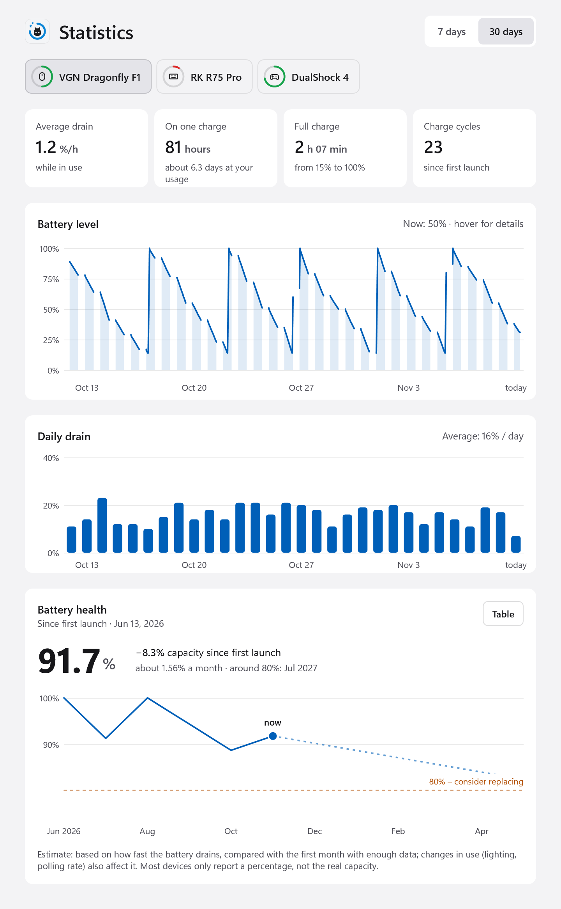</a> 
      <strong>Battery health</strong> 
      Estimated capacity since NapCat first saw the device, from how fast the battery drains compared with the first month, with a projection to 80%. The history is simulated here.
    </td>
  </tr>
</table>

## Tray icons

<table>
  <tr>
    <td width="50%" valign="top">
      <a href="tray/icon-styles.png">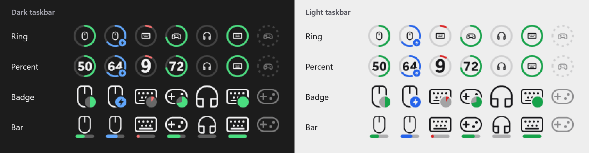</a> 
      <strong>Icon styles</strong> 
      Ring, percent, badge and bar styles for 50%, charging, 9%, 72%, unknown, full and disconnected devices.
    </td>
    <td width="50%" valign="top">
      <a href="tray/app-icon-states.png">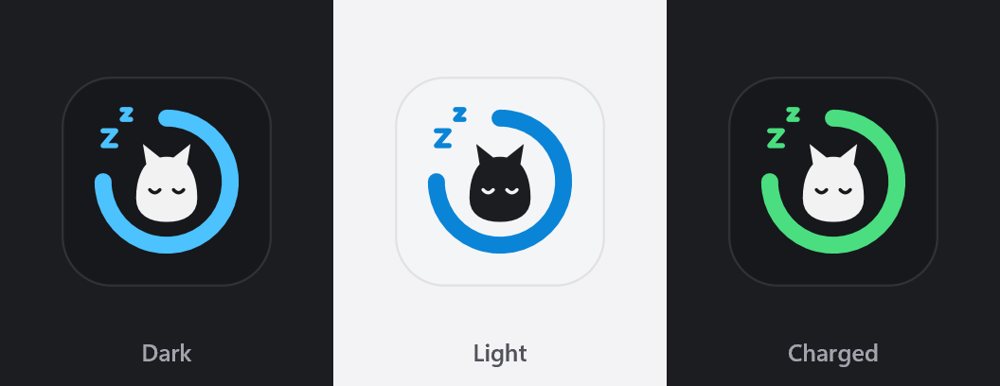</a> 
      <strong>App icon</strong> 
      Dark, light, and green when every connected device is fully charged.
    </td>
  </tr>
</table>

